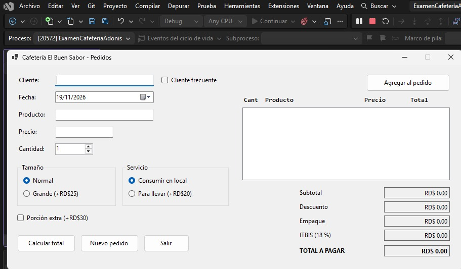
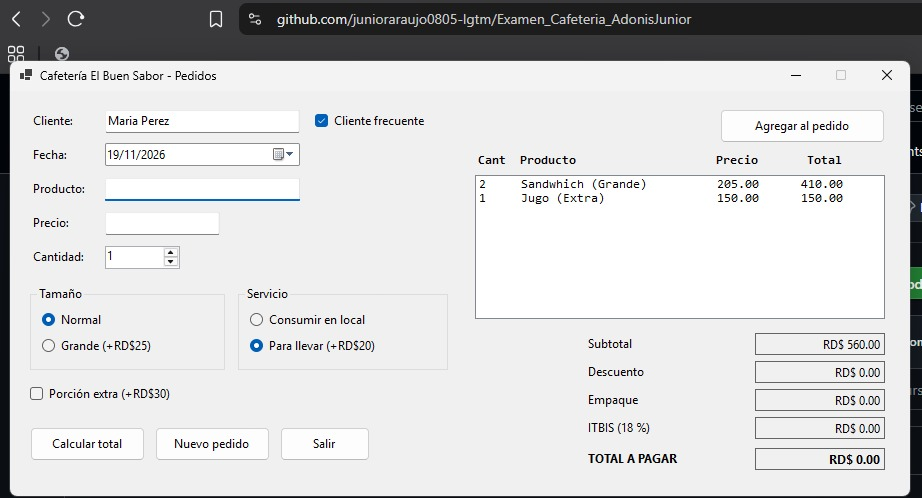
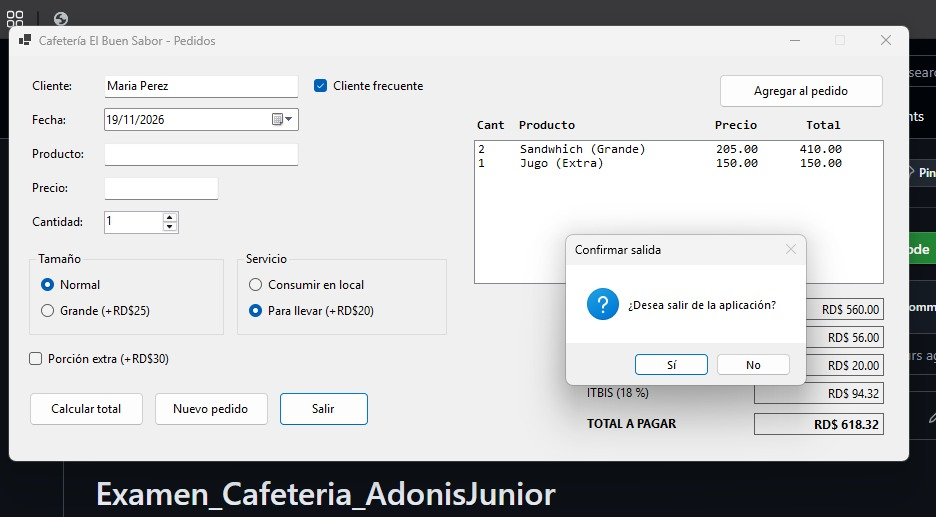
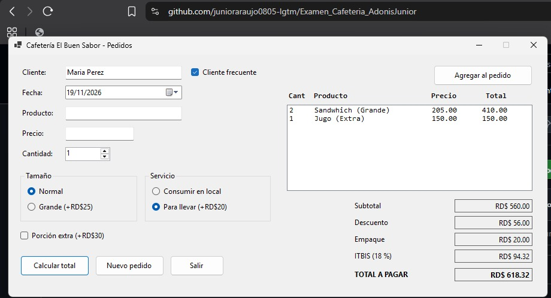

# Cafetería "El Buen Sabor" - Examen Práctico

## 1. Nombre y matrícula
Adonis Alburquerque — Matrícula: 2025-3296

## 2. Descripción del programa
Sistema en C# Windows Forms para tomar pedidos en la cafetería "El Buen Sabor". Permite agregar productos con su cantidad, aplicar recargos por tamaño grande o porción extra, descontar a clientes frecuentes, cobrar el empaque si es para llevar y sacar el ITBIS y el total final.

## 3. Datos de entrada
- Nombre del cliente (`txtCliente`)
- Casilla de cliente frecuente (`chkFrecuente`)
- Fecha del pedido (`dtpFecha`)
- Nombre del producto (`txtProducto`)
- Precio base (`txtPrecio`)
- Cantidad del 1 al 20 (`nudCantidad`)
- Tamaño: Normal o Grande (`rbtNormal`, `rbtGrande`)
- Porción extra (`chkPorcionExtra`)
- Tipo de servicio: Consumir en local o Para llevar (`rbtLocal`, `rbtLlevar`)

## 4. Proceso
1. Toma el precio del producto y le suma RD$25 si se eligió Grande y RD$30 si lleva porción extra.
2. Multiplica ese precio unitario por la cantidad para sacar el total de la línea y lo va sumando al subtotal.
3. Si está marcado como cliente frecuente, calcula el 10 % de descuento sobre el subtotal.
4. Si el pedido es para llevar, agrega RD$20 una sola vez por el empaque.
5. Calcula la base imponible (`subtotal - descuento + empaque`), aplica el 18 % de ITBIS y obtiene el total a pagar.

## 5. Salida
- Lista de productos (`lstPedido`) con su encabezado (`Cant`, `Producto`, `Precio`, `Total`) ordenado en columnas.
- Montos mostrados como `RD$ 0.00` en Subtotal, Descuento, Empaque, ITBIS y Total a pagar.

## 6. Capturas de pantalla

